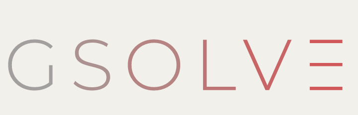

<table>
<tr>
  <td>Latest Release</td>
  <td>
    <a href="https://pypi.org/project/gsolve/">
    
    </a>
    <a href="https://anaconda.org/channels/conda-forge/packages/gsolve/overview">
    
    </a>
    <a href="https://anaconda.org/channels/conda-forge/packages/gsolve/overview">
    
    </a>
</tr>

<tr>
  <td>License</td>
  <td>
    <a href="https://github.com/gns-science/gsolve/blob/main/LICENSE">
    
    </a>
</td>
</tr>

<tr>
  <td>Build Status</td>
  <td>
    <a href="https://gns-science.github.io/gsolve/">
    
    </a>
    <a href="https://github.com/GNS-Science/gsolve/actions/workflows/test_and_build.yml">
      
    </a>
    <a href="https://codecov.io/gh/GNS-Science/gsolve">
    
    </a>
  </td>
</tr>

<tr>
  <td>Publications</td>
  <td>
    <!--<a href="https://doi.org/">-->
    <!---->
    </a>
    <!--<a style="border-width:0" href="https://doi.org/">
    <!---->
    </a>
  </td>
</tr>
</table>


# gSolve

gSolve, a Python computer library by Earth Sciences New Zealand (formerly GNS Science) to transform relative gravity survey measurements to absolute gravity values and gravity anomalies and disturbances.

It is suitable for time varying gravity as well as Bouguer gravity.

This version is a substantial re-write of the previous python version to remove the limitation of a graphical user interface and to update to python 3 with modern software management.

## Functionality

Process gravity data for time change microgravity and Bouguer surveys.

## Data Import

* Several input formats including manually read LaCoste and Romberg meters, Nomad upgraded L and R meters and the Scintrex CG6 meter instrument file.

## Algorithm

* calculate the meter calibration correction, beta.
* corrects for earth tide using Longman and [ETERNA](https://github.com/hydrogeoscience/pygtide/) formula.
* option to correct for ocean loading using [pyhardisp](https://github.com/craigmillernz/pyhardisp).
* correct for drift across loops or whole survey.
* network adjustment with three different network adjustment algorithms depending on user requirements.

# calibrate meters to absolute values

* residuals can be filtered using a percentile cut filter.

## Corrections

* calculate normal gravity.
* calculate terrain corrections.
* calculate free air, simple and complete bouguer anomalies.

## Plotting

* plot raw observations
* residual cumulative probability density functions, CDF.
* drift curve
* network map

## Data export

* export to csv or excel with comprehensive metadata
* save plot files

# Installation
```
pip install gsolve
```
or
```
conda install gsolve -c conda-forge
```

# Usage

Example scripts are provided to demonstrate the software capability.

# Support

Full documentation is available here. [gSolve](https://gns-science.github.io/gsolve/)

# Authors and acknowledgment

gSolve builds on many previous authors.

The current author team is Adrian Benson, Alison Kirkby, Craig Miller, Aleksandr Spesivtsev, Vaughan Stagpoole.

This version supersedes previous Gsolve versions e.g.
McCubbine, J., Tontini, F. C., Stagpoole, V., Smith, E., & O’Brien, G. (2018). Gsolve, a Python computer program with a graphical user interface to transform relative gravity survey measurements to absolute gravity values and gravity anomalies. SoftwareX, 7, 129–137.

# How to cite gSolve

Link to JOSS paper here when it is ready.

# System requirements

Python 3.12+

# License

Licensed with GPLv3.
